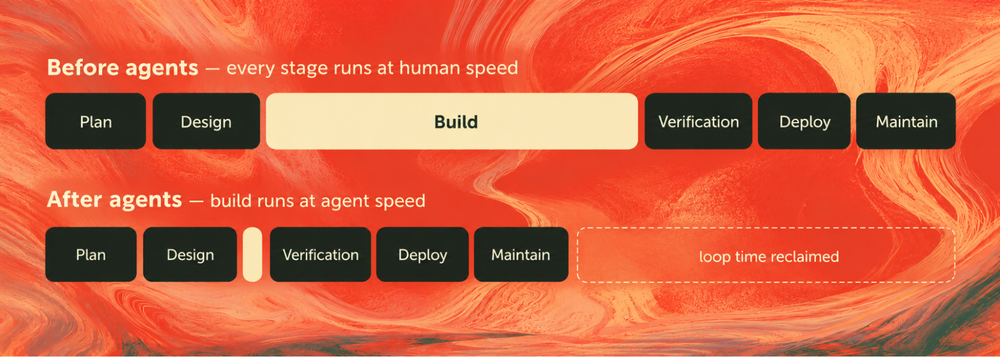

Are you a software engineer in 2026 if you haven’t built a chatbot? This year I worked with a client to build a coaching assistant. It highlighted how building software has changed with coding agents. And why focusing on the build loop, design, and verification is more important than ever...

## Design is more important than ever...

Product Requirement Documents (PRDs) are useful to capture the intent behind what you want to build, and how your users will perceive it. They've been great for communicating between larger teams and stakeholders, and now they're surprisingly good at communicating with your coding agent.

There’s no single best format for PRDs, and it's often organisation specific. A PRD should capture the needs of your users: what is the problem you’re trying to solve? And what’s your proposed solution?

Interactive prototypes with Claude Design or Lovable are also great at communicating UX interactions that are hard to define with text or diagrams.

Design is a perfect time to identify your biggest unknowns and critical components. What are the assumptions you have, and what if they’re not what you expect? If you don’t know the answers to these, how do you expect your agent to?

For the coaching chatbot, we were worried about latency: if it didn’t respond quickly the experience would feel unnatural and unusable. We also wanted to experiment with input UX and different input modes.

## Verification is more important than ever...

Building has drastically sped up, so verification is even more important! If you can’t get quick, reliable feedback then you drown in open PRs or commit SLOP. For us this meant daily TestFlight releases, and a simple way to report feedback in Notion with screenshots (simple is better).

One building hack we found was decoupling verification steps from our regular build cycle. Separating the coaches’ system prompt meant we could verify behaviour without waiting for a release. This kept our verification lean. We used langfuse.com’s ‘Prompt Management’ feature to dynamically load prompts.

## Looping design and verification...

Shipping human focused software means you need to... include the human a lot. Once design and verification are nailed, spin the design > build > verification loop and get building!

Our focus was ensuring chat interactions felt natural, and that text/voice inputs were intuitive. Technology with voice and input UX was improving rapidly, and spinning fast meant we could explore and find the best solution.

Conversational AI can be split into three distinct steps: `Speech to text > LLM thinking > Text to speech`

Initially we chose a different technology for each step of an interaction. While it was powerful to customise a solution, the latency introduced at each step created long pauses that felt unnatural.

Luckily during building, OpenAI released their Realtime API (https://developers.openai.com/api/docs/models/gpt-realtime). After verification we realised this solution was superior: streaming from `Audio In > Audio Out` meant lower latency, and it was also easier to set up and maintain.

## Conclusion

The rules of building robust software haven't changed: you're still signing your name against changes you ship to production. To maintain quality you have to focus on managing your agent's build loop.

The focus now shifts to the stages before and after building. Optimising design and verification is the key to ensuring the loop doesn't fly off its wheels, compounding into a maintenance nightmare or confusing slop.
